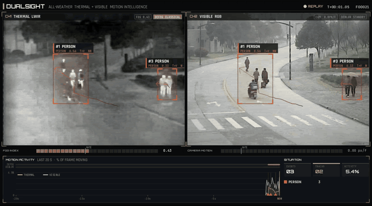
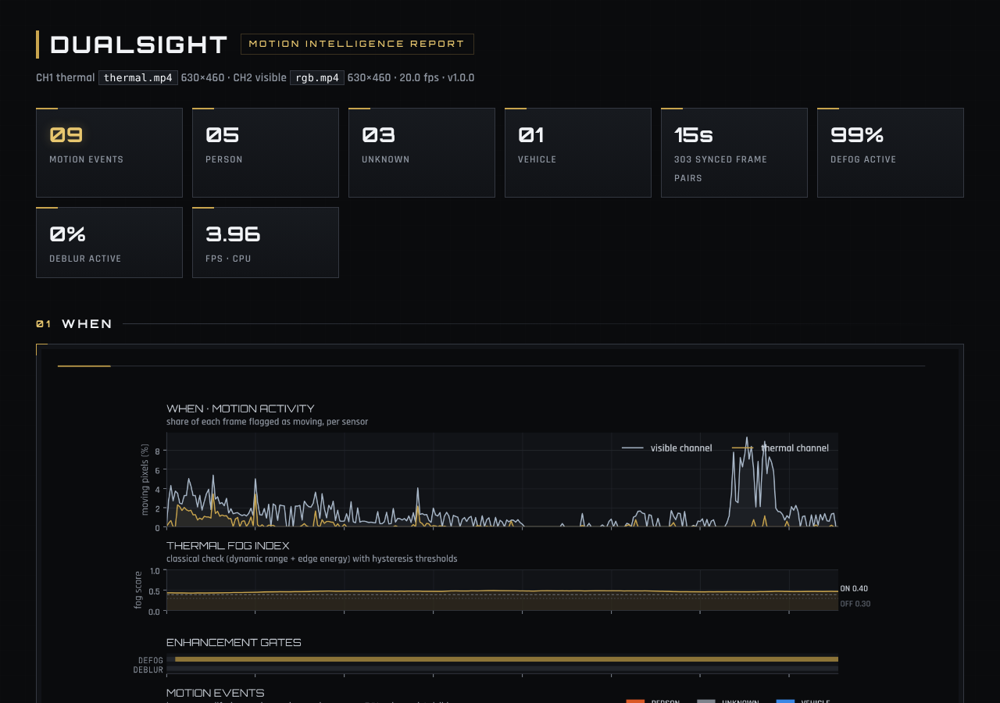
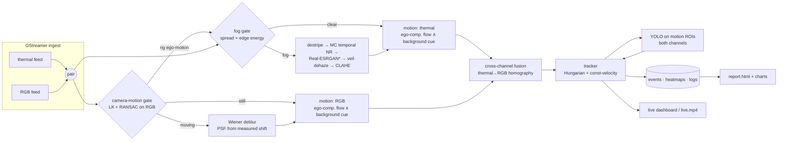
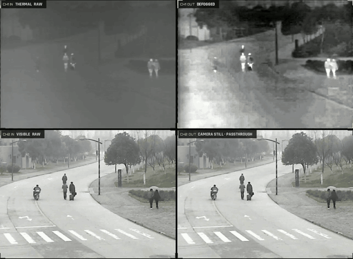
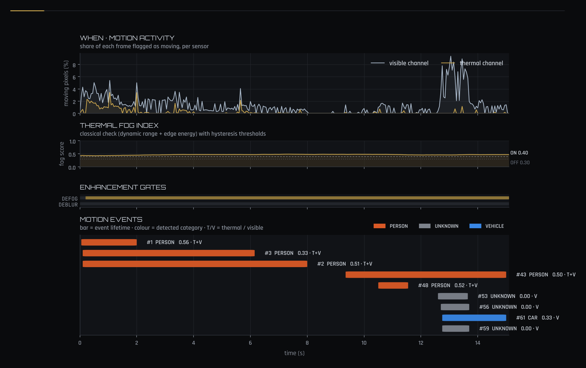
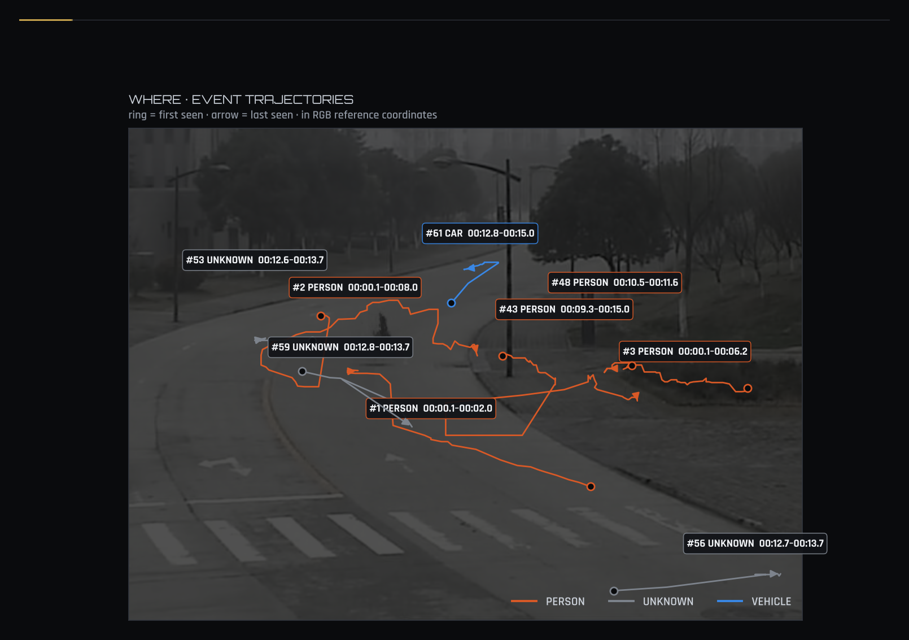
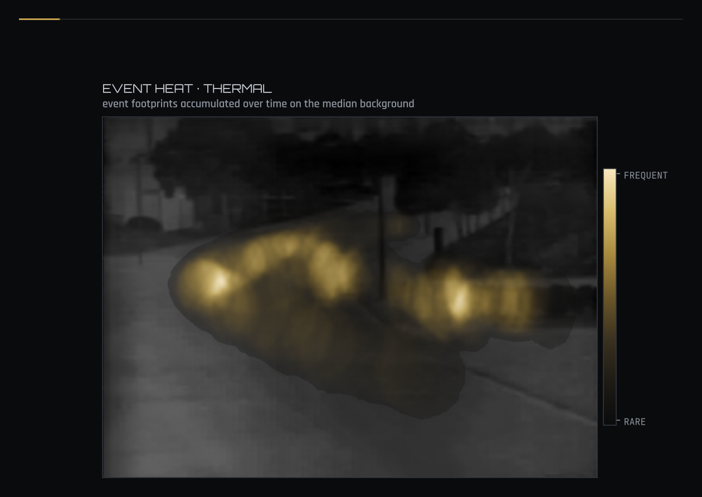
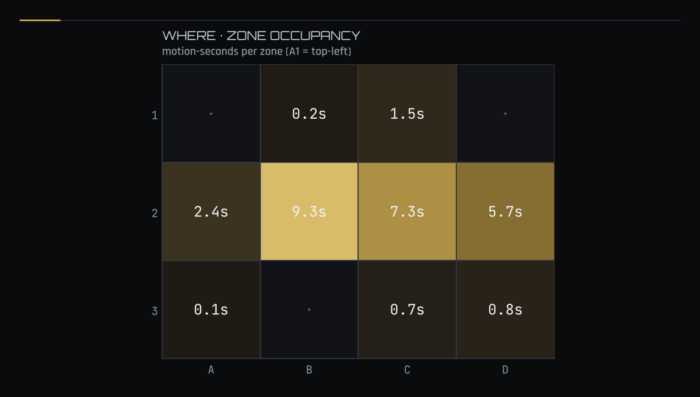
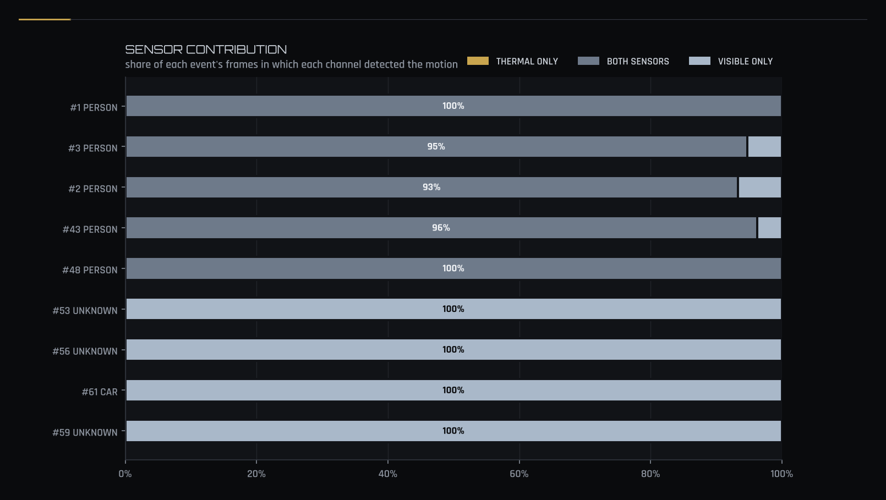
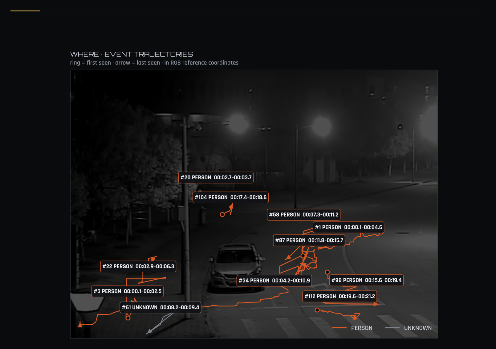

# DualSight

**All-weather thermal + RGB motion intelligence.** Two synchronised camera feeds go in. The system enhances each feed only when a classical check says it needs it, finds anything that moves with GPU-accelerated optical flow, works out *what* is moving, and reports *when* and *where* it happened.



<sub>Operator HUD on **real footage**: VOT-RGBT / RGBT234 static cameras in fog (`fog6`), at night (`walkingnight`) and at an intersection (`crossroad`); see [Real footage](#real-footage). CH1 is thermal with adaptive defog and CH2 is visible with camera-motion deblur. The HUD also shows the gate gauges with their thresholds, rolling activity per sensor, event ticks and situation counters.</sub>



---

## About this repository

> **This is a public re-implementation of a production system. It contains none of the original project's resources.**
>
> The original system was built for a **defense border-surveillance program**: detect *any* motion along a national boundary, day and night, in fog, haze, dust and rain, from a dual thermal/visible sensor head. That system uses **different code**. Its algorithmic structure is almost the same as the one here, but it was **fine-tuned on the deployment environment**. Its **object detector was custom-trained for the product's target classes**, and its **motion detector was customised as well**.
>
> This repository is **pre-defined with published models only**: Ultralytics YOLO11 (COCO), Real-ESRGAN, torchvision RAFT, and classical OpenCV algorithms. Its purpose is to show the pipeline's decision rules and the capability of each stage. It runs on **synthetic demo data generated by the repo itself**, so no project footage, data, weights, calibration or code is shared.

## What it does

| # | Stage | How |
|---|---|---|
| 1 | **Thermal defog, only when needed** | A classical fog check (robust dynamic range + edge energy → `fog_score`, hysteresis gate) decides per frame. When it fires: destripe → motion-compensated temporal NR → **veil-aware dehaze** (dark-channel-style prior adapted to LWIR) → CLAHE. On GPU, **Real-ESRGAN ×4** runs as a learned detail restorer *before* the veil inversion (`hybrid`). |
| 2 | **RGB deblur, if and only if the camera moves** | Rig motion is measured from grid-distributed corners (LK + RANSAC, with a static-support test). When it exceeds the gate, a linear motion PSF built from the measured shift drives **Wiener deconvolution** (in `torch.fft`, so it runs on GPU too), followed by de-ringing. |
| 3 | **Motion detection on both channels** | **Ego-compensated dense optical flow** (DIS on CPU; CUDA Farneback, NVIDIA OF or RAFT on GPU) is fused with a **background cue** (MOG2 while still, aligned differencing while panning). An adaptive threshold, blob SNR test and atmospheric-transition guard keep fog fronts and shimmer out. |
| 4 | **Who/what made the motion** | Only motion regions are cropped and sent to the detector (ROI mode), every *N* frames, on **both** channels. Detections vote into the motion tracks, and COCO classes fold into `person / vehicle / animal / vessel / aircraft`. |
| 5 | **Report: when & where & what** | A timeline per channel, the gate states, an event Gantt chart, event heatmaps per channel, trajectories with headings, a zone table, a heading rose, stage latency, plus `events.csv` and a self-contained `index.html`. |

The two feeds are ingested through **GStreamer** (files, RTSP, RTP/UDP, V4L2 or a raw `gst:` pipeline, with optional NVDEC/Jetson decode) and **paired on timestamps**. Offline videos can be replayed *as a live stream* with `--realtime`, which drops frames when processing falls behind.

## Pipeline


<sub>* Real-ESRGAN in `hybrid`/`esrgan` mode (default on GPU). Each gate's input and decision is logged per frame, so every enhancement decision can be audited later.</sub>

### Decision rules (the "pipeline rules")

| Rule | Default | Why |
|---|---|---|
| Thermal enhancement ON when the smoothed `fog_score ≥ 0.40` for 5 frames, OFF when `≤ 0.30` for 5 frames | `thermal.gate` | Hysteresis prevents flicker. Enhancement is skipped in clear weather, which saves compute and avoids amplifying noise. |
| Dehaze strength ∝ fog score | `clip(1.6·fog, 0.35, 1)` | Light haze gets a light touch. |
| RGB deblur ON only while the rig shift is `≥ 2.5 px/frame` | `rgb.gate` | Exactly the requirement: deblur only when the classical check reports camera motion. |
| Rig ego-motion is measured once (RGB corners) and shared with the thermal channel | `motion.ego.share_rig_motion` | Both sensors sit on one head. Thermal flow is unobservable in flat fog, where it would read as a static camera. |
| A blob counts as motion only if flow **and** the background cue agree | `motion.combine: and` | Fewest false alarms on a perimeter. Use `or` for maximum recall. |
| Blob mean residual flow `≥ 1.5×` the threshold (`×2` during fog transitions) | `min_blob_snr`, `transition_guard` | Rejects drifting haze, heat shimmer, and the global radiance drift while fog rolls in or clears. |
| An event needs `≥ 1 s`, plus a detector label **or** a real displacement | `tracking` | Unattributed jitter never becomes an alarm. Unknown movers that travel are kept as `unknown`. |
| The detector runs only on motion ROIs, every 3 frames, on both channels | `detector` | Spends compute where the motion is. Thermal still attributes targets when RGB is blind. |

## Quick start

```bash
git clone https://github.com/HazemMamdouh/dualsight.git && cd dualsight
pip install -e .            # CPU works out of the box; install a CUDA torch for GPU

# 1. synthesize the demo pair (people, a vehicle and an animal; fog; pan + shake)
dualsight make-demo --out data/demo

# 2. run the pipeline (live window + saved dashboard + enhanced streams)
dualsight run --thermal data/demo/thermal.mp4 --rgb data/demo/rgb.mp4 \
              --out runs/demo --device cuda --show --save-video --save-processed

# 3. re-render from the outputs + inputs (final labels) and a before/after video
dualsight render --run runs/demo --compare
open runs/demo/report/index.html
```

`scripts/run_demo.sh` does all three steps in one go.

### Real footage

The showcase on this page runs on **real, pixel-aligned thermal + visible recordings from static surveillance cameras**: sequences of the [VOT-RGBT challenge](https://www.votchallenge.net/) (a subset of RGBT234). They include real fog, night and traffic, which is the closest public match to a perimeter-monitoring head.

```bash
pip install -e ".[data]"
dualsight fetch-data vot-rgbt --list                                  # fog6, fog, walkingnight, crossroad, ...
dualsight fetch-data vot-rgbt --seq fog6,walkingnight,crossroad --out data/vot
dualsight run --thermal data/vot/fog6/thermal.mp4 --rgb data/vot/fog6/rgb.mp4 --out runs/real_fog6 --save-video
dualsight render --run runs/real_fog6 --compare

scripts/build_showcase.sh                                             # all of the above + regenerate docs/assets
```

`dualsight fetch-data kaist --set set05` also downloads the **KAIST Multispectral** night-downtown sequence. It is real but **vehicle-mounted**, so the camera moves with parallax almost all the time. That is a harder regime than a fixed perimeter camera, and it is useful as a stress test. For any other paired dataset (LLVIP raw videos, your own captures), `dualsight frames-to-video --thermal-dir … --rgb-dir … --out …` turns two index-aligned frame folders into synced streams. OpenCV image-sequence patterns such as `--thermal frames/ir/%05di.jpg` also work directly as inputs.

> The footage is research-use data: RGBT234 / VOT-RGBT (Li et al., *Pattern Recognition* 2019) and KAIST (Hwang et al., CVPR 2015, CC BY-NC-SA 4.0). It is downloaded on demand and never committed. `fetch-data` writes a `SOURCE.txt` with the attribution next to every sequence. RGBT234 sequences are image series and are played back at 20 fps.

### `dualsight run`

| flag | meaning |
|---|---|
| `--thermal`, `--rgb` | file, `rtsp://…`, `udp://0.0.0.0:PORT`, `/dev/videoN`, or `gst:<pipeline>` |
| `--device auto\|cpu\|cuda\|cuda:N\|mps` | selects the GPU paths: Real-ESRGAN, torch-FFT deblur, RAFT/CUDA flow, YOLO fp16 |
| `--show` / `--save-video` | live visualization window, and/or save it to `live.mp4` |
| `--save-processed` | also write `thermal_enhanced.mp4` and `rgb_deblurred.mp4` |
| `--realtime` | replay files at native rate, dropping frames when behind (live-stream behaviour) |
| `--gstreamer` / `--no-gstreamer`, `--hw-decode none\|nvidia\|jetson` | choose the ingest backend |
| `--thermal-enhancer auto\|classical\|esrgan\|hybrid\|off` | `auto` is `hybrid` on GPU and `classical` on CPU |
| `--flow auto\|dis\|farneback\|cuda_farneback\|nvof\|raft` | optical-flow backend |
| `--detector yolo11s.pt` / `--no-detector` | any Ultralytics detection model, including a TensorRT `.engine` |
| `--config configs/gpu.yaml`, `--set key=value` | presets and single-key overrides |

### `dualsight render`

Rebuilds visualizations **from a run directory plus the input videos**. A run stores decisions (gate states, measured camera shifts, tracks, final labels), not pixels, so a render can re-apply the logged enhancement and draw final, vote-settled labels.

| flag | meaning |
|---|---|
| `--view enhanced\|raw` | draw on the re-enhanced frames or on the untouched inputs |
| `--compare` | also write a 2×2 before/after video (thermal defog, RGB deblur) |
| `--no-report` | skip rebuilding the report |



## Outputs

```
runs/demo/
├── run.json            # config, backends, stream info, sync stats, per-stage latency, event summary
├── pipeline.log
├── frames.csv          # per frame: fog metrics + gate, camera shift + gate, motion per channel, counts, latency
├── frames.jsonl        # per frame: tracks (box, sources, label, heading), blobs per channel, detections
├── events.json         # final motion events: category, class, confidence, start/end, seen_by, heading, speed, path
├── detections.csv      # every detector hit with its channel and the track it voted for
├── heatmap_{thermal,rgb,fused}.npy, background_{thermal,rgb}.png
├── live.mp4, thermal_enhanced.mp4, rgb_deblurred.mp4     (optional)
├── render.mp4, compare.mp4                               (dualsight render)
└── report/  index.html · events.csv · timeline · heatmaps · trajectories · zones · categories · headings · performance
```

## Results on real footage

These runs used the default configuration on real VOT-RGBT / RGBT234 sequences: static cameras, pixel-aligned 630×460 thermal + visible, played back at 20 fps, on a 2-vCPU container with no GPU.

| sequence | conditions | frames | defog active | events (detector-attributed) | throughput |
|---|---|---|---|---|---|
| `fog6` | real fog, campus road | 303 | 99 % | 5 person · 1 vehicle (scooter) · 3 unattributed | 4.0 fps |
| `walkingnight` | night, street lights, parked car | 426 | 0 % | 10 person · 1 unattributed | 5.5 fps |
| `crossroad` | day, intersection traffic | 768 | 0 % | 7 person · 2 vehicle · 1 unattributed | 5.9 fps |

The classical fog check switches defog on for the fog sequence and keeps it off at night and in daylight. No sequence has camera motion, so deblur stays idle, as the gate intends. These sequences have no motion-event ground truth. The numbers above are counts, not accuracy: slow walkers in tight groups are sometimes merged into one event or missed. The scored evaluation is below.

| when (fog6) | where (fog6) |
|---|---|
|  |  |
|  |  |
|  |  |

## Scored evaluation (built-in test scene)

Real paired footage with ground-truth motion events *and* real fog is not publicly available, so accuracy is scored on the built-in test scene (`dualsight make-demo`). It has frame-exact ground truth: 48 s, 640×360 thermal + 1280×720 RGB at 15 fps. In it, a person walks while the rig pans, a motorcycle crosses in heavy fog during a second pan, a horse crosses as the fog clears, and two people walk during hand-held shake. `scripts/eval_synthetic.py` scores a run:

| actor | visible | detected | category | detector class | coverage |
|---|---|---|---|---|---|
| person #0 | 4.4–13.6 s | ✅ | person | person | 100 % |
| vehicle #1 (in heavy fog) | 17.2–23.6 s | ✅ | vehicle | motorcycle | 100 % |
| animal #2 | 27.9–35.3 s | ✅ | animal | dog* | 100 % |
| person #3 | 37.3–45.1 s | ✅ | person | person | 100 % |
| person #4 | 38.6–46.4 s | ✅ | person | person | 100 % |

**5/5 actors detected with the correct category, 0 false events.** The fog gate agrees with the ground truth on 97.2 % of frames and the camera-motion gate on 96.7 % (the misses are hysteresis onset/offset frames).
<sub>* The horse is a silhouette cut-out; COCO-YOLO11n votes `dog` over `horse`, while the folded category (`animal`) is correct.</sub>

**Throughput, measured:** 4–6 fps end-to-end on a **2-vCPU cloud container with no GPU**. That includes YOLO11n on CPU, classical defog, Wiener deblur, two DIS flows, dashboard rendering and H.264 encoding. The detector dominates (≈200 ms per call). Run your own numbers: per-stage p50/p95 latencies are written to `run.json` and `report/performance.png`. In `hybrid` mode, Real-ESRGAN is a GPU feature: on the same CPU it costs ≈8 s per frame.

## Visual identity

All visual outputs share one theme from `dualsight/viz/style.py`: the live HUD, the rendered videos, the report charts and the HTML report. It uses a graphite-black surface, silver ink and a muted gold accent, with thin 1–1.2 px data lines, set in Orbitron, Rajdhani and JetBrains Mono (bundled, SIL OFL). The channels keep their meaning everywhere: **gold = thermal (heat)** and **silver = visible**. The categories are person (orange), vehicle (blue) and animal (aqua). These three colours are a validated categorical set on the dark surface: they pass the lightness-band, chroma, all-pairs colour-blind and normal-vision separation checks. Labels always repeat the category in text. To re-brand, edit the constants in `style.py`; nothing else changes. `viz.thermal_cmap: theme` renders the thermal panel graphite → gold → white.

## Engineering notes

* **Defog order matters.** Fog in LWIR is a low-frequency radiance veil, `I = J·t + A·(1−t)`. Super-resolution alone restores texture but leaves the veil, and the veil inversion `1/t` amplifies whatever noise is left. So the chain cleans first (destripe, motion-compensated temporal NR, optional Real-ESRGAN), inverts the veil second, and smooths `A`, the transmission reference and the stretch over time so the output does not flicker.
* **A shared rig motion beats per-sensor estimates.** In flat fog, thermal flow is unobservable and reads ≈0. A per-channel ego estimate then calls a panning camera "still" and floods the frame with false motion. Measuring the rig motion on RGB corners (with a static-support test, so big moving targets cannot out-vote the background) and sharing it fixed this.
* **Fog fronts are motion, but not targets.** While fog rolls in, brightness constancy breaks across the whole scene. The fog score's rate of change triggers a transition guard that temporarily raises the blob SNR bar.
* **Deconvolution only redistributes energy.** After Wiener, the output is clamped to the local min/max of the blurred input. This removes the ringing around people who move against the camera's motion.
* **Events, not blobs.** Fragments of one object (a gate toggle, a fog patch, a long animal split in two) are merged by a constant-velocity tracker and a consolidation pass.

## Repository layout

```
dualsight/
  io/          sources.py (GStreamer/FFmpeg ingest + timestamp sync) · writers.py (H.264 via ffmpeg)
  enhance/     quality.py (fog & camera-motion gates) · thermal.py (defog, TNR, Real-ESRGAN) · deblur.py · esrgan_arch.py
  motion/      flow.py (DIS / CUDA Farneback / NVOF / RAFT) · detector.py (ego-comp. flow + bg cue) · tracker.py
  detect/      detector.py (YOLO on motion ROIs, class folding, vote association)
  analytics/   report.py (charts, HTML report, events.csv)
  viz/         overlay.py (live dashboard) · style.py
  synth/       real_data.py (KAIST downloader, frame-folder → synced streams) · scene.py (scored test scene + ground truth)
  assets/      fonts (Orbitron, Rajdhani, JetBrains Mono · SIL OFL)
  pipeline.py · render.py · cli.py · config.py
configs/       default.yaml · gpu.yaml · jetson.yaml
scripts/       build_showcase.sh (real footage → docs/assets) · run_demo.sh · stream_pair_udp.sh (live RTP replay) · eval_synthetic.py
docs/          deployment.md (GStreamer, Jetson, registration, calibration)
tests/         unit tests for gates, enhancers, motion, tracker, sync, CLI
```

## Limitations of this public version

* Published COCO weights instead of the product's custom detector: thermal-only attribution is weaker, and there are no domain-specific classes.
* Gate thresholds are calibrated on the synthetic camera. Recalibrate on your sensor using the logged `fog_score` and `cam_shift` (see [docs/deployment.md](docs/deployment.md)).
* The deblur PSF is linear and global. Rotational shake and rolling-shutter effects are out of scope here.
* The scored test scene is composited (real-photo cut-outs, physically motivated fog and blur) because public paired thermal + RGB video with real fog *and* ground truth is scarce. Real footage (VOT-RGBT, KAIST) has no motion-event ground truth, so it is used for the showcase and for tuning, as described in [docs/deployment.md](docs/deployment.md).

## Third-party components

Fonts: [Orbitron](https://github.com/google/fonts/tree/main/ofl/orbitron), [Rajdhani](https://github.com/google/fonts/tree/main/ofl/rajdhani), [JetBrains Mono](https://github.com/JetBrains/JetBrainsMono) (SIL OFL 1.1, licence files in `dualsight/assets/fonts`). Real footage: [VOT-RGBT](https://www.votchallenge.net/) / RGBT234 (research use) and [KAIST Multispectral Pedestrian](https://soonminhwang.github.io/rgbt-ped-detection/) (CC BY-NC-SA 4.0), both downloaded on demand and not redistributed. · [Ultralytics YOLO](https://github.com/ultralytics/ultralytics) (AGPL-3.0) · [Real-ESRGAN](https://github.com/xinntao/Real-ESRGAN) weights (BSD-3-Clause) · [torchvision RAFT](https://pytorch.org/vision/stable/models/raft.html) (BSD-3-Clause) · OpenCV (Apache-2.0). Demo sprites are cut at runtime from sample images bundled with `ultralytics` and `scikit-image`, and they are not redistributed here. Check the Ultralytics license before any commercial use of a derivative.

## Author

**Hazem Mamdouh**, Senior ML Engineer / AI Technical Lead (computer vision, edge deployment, production CV systems) · [hazemmamdouh.github.io](https://hazemmamdouh.github.io)
